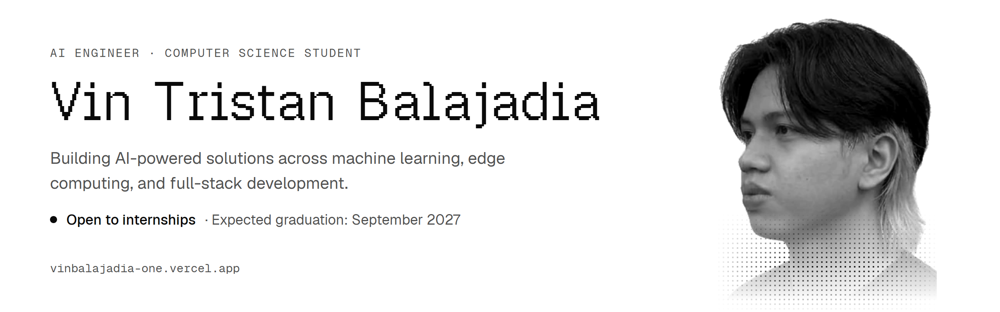

<a href="https://vinbalajadia-one.vercel.app">
  <picture>
    <source media="(prefers-color-scheme: dark)" srcset="assets/banner-dark.png">
    
  </picture>
</a>

  <a href="https://vinbalajadia-one.vercel.app">
    <picture>
      <source media="(prefers-color-scheme: dark)" srcset="https://img.shields.io/badge/Portfolio-f4f4f5?style=for-the-badge">
      
    </picture>
  </a>
  <a href="https://vinbalajadia-one.vercel.app/vin-tristan-balajadia-resume.pdf">
    <picture>
      <source media="(prefers-color-scheme: dark)" srcset="https://img.shields.io/badge/R%C3%A9sum%C3%A9-f4f4f5?style=for-the-badge">
      
    </picture>
  </a>
  <a href="https://ph.linkedin.com/in/vin-tristan-balajadia-a85a56383">
    <picture>
      <source media="(prefers-color-scheme: dark)" srcset="https://img.shields.io/badge/LinkedIn-f4f4f5?style=for-the-badge">
      
    </picture>
  </a>
  <a href="mailto:balajadiavintristan@gmail.com">
    <picture>
      <source media="(prefers-color-scheme: dark)" srcset="https://img.shields.io/badge/Email-f4f4f5?style=for-the-badge">
      
    </picture>
  </a>

  Have a question about my work? <a href="https://vinbalajadia-one.vercel.app"><b>Ask the AI assistant on my portfolio</b></a>. 
  It answers from my résumé, in English or Filipino.

## 01 — About

I'm a Computer Science student at **FEU Institute of Technology** (BS Computer Science, specializing in Software Engineering; expected graduation **September 2027**), working toward a career as an **AI Engineer**. My work spans machine learning, edge computing, and full-stack development, with a focus on turning ideas into practical, usable applications.

- **Now:** building [Harap](https://github.com/vinbalajadia/Harap), an AI interview coaching platform
- **Interested in:** real-time computer vision and on-device machine learning on edge hardware like the Raspberry Pi
- **Open to:** internships. Reach me by [email](mailto:balajadiavintristan@gmail.com) or on [LinkedIn](https://ph.linkedin.com/in/vin-tristan-balajadia-a85a56383)

## 02 — Featured projects

### APo · Real-Time Elderly Activity Monitoring

**Machine Learning Engineer** · [Demo video ↗](https://drive.google.com/drive/folders/1AhwCfuuywkNDzgVPo-6LsQ_fOmeeja_g)

Keeping track of an older adult's activity usually takes someone watching, in person or on camera. APo recognizes activities from a camera feed in real time on a Raspberry Pi and shows the latest detected activity in a mobile app. I developed and optimized its motion pre-filtering and MobileNet-based activity recognition pipeline.

| Accuracy | Mean latency | Average CPU usage |
| :---: | :---: | :---: |
| **98.83%** | **25.25 ms** | **71.39%** (down from 79.41%) |

`Python` `TensorFlow` `OpenCV` `MediaPipe` `MobileNet` `Raspberry Pi`

### Harap · AI Interview Coaching Platform

**Full-Stack Developer** · In development · [Repository ↗](https://github.com/vinbalajadia/Harap)

*"Face every interview with confidence."* Harap is Filipino for "face." It's designed as a personal AI mentor for aspiring software engineers, with realistic mock interviews, personalized AI feedback, and progress tracking. I'm building it as a type-safe monorepo with Turborepo, TanStack Query, Zod, Vitest, pnpm, and GitHub Actions.

`React 19` `TypeScript` `Node.js` `Express 5` `PostgreSQL` `Supabase` `OpenAI API`

### TAKO · AI-Powered Gamified Study Companion

**Database Administrator** · 🏆 **2nd Runner-Up out of 40 teams**, ACM TechSprint Hackathon (FEU Tech) · [Demo video ↗](https://drive.google.com/drive/folders/1j659qZ_r7TiUOjS0bUmvKTWz3gKcODEp) · [Repository ↗](https://github.com/vinbalajadia/tako-game)

Many Filipino students can't easily get a tutor, have slow or unreliable internet, or learn best in Filipino. Built for a hackathon challenge from Accenture, TAKO is an RPG-based study companion that explains concepts in Filipino and English, offers adaptive practice, and is designed to work on low-bandwidth connections. I managed its Supabase data layer.

`Godot` `React.js` `Supabase`

## 03 — Tech stack

<table>
  <tr>
    <td><b>Languages</b></td>
    <td>
      
      
      
      
      
    </td>
  </tr>
  <tr>
    <td><b>AI & edge computing</b></td>
    <td>
      
      
      
       MediaPipe · MobileNet · CUDA · OpenACC
    </td>
  </tr>
  <tr>
    <td><b>Web development</b></td>
    <td>
      
      
      
      
      
      
      
       Express
    </td>
  </tr>
  <tr>
    <td><b>Data & tools</b></td>
    <td>
      
      
      
      
      
       GitHub
    </td>
  </tr>
</table>

Also: object-oriented programming, data structures and algorithms, and GUI development.

## 04 — GitHub activity

<picture>
  <source media="(prefers-color-scheme: dark)" srcset="assets/github-stats-dark.svg">
  
</picture>

## 05 — Certifications & community

- **[IT Specialist – Python](https://www.credly.com/badges/829cc47d-0892-446d-afde-25caff206e93)** · Certiport (Pearson VUE) · July 2025
- **[PMI Project Management Ready™](https://www.credly.com/badges/e4e0cf0f-4cfa-4163-8020-ddfc6b5f8acd)** · Project Management Institute · March 2026
- **Association for Computing Machinery** · Junior Officer, Logistics Committee · September 2025 – June 2026

Want the full picture? Visit <a href="https://vinbalajadia-one.vercel.app">vinbalajadia-one.vercel.app</a>.

