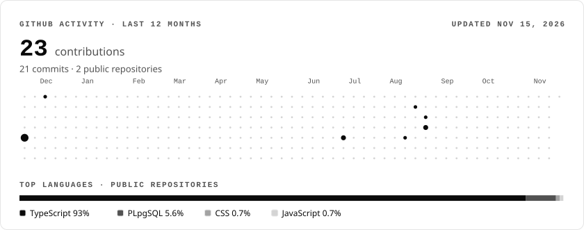
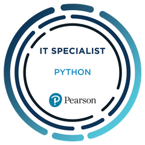
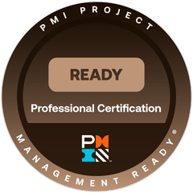

<h1 align="center">Vin Tristan Balajadia</h1>

  <b>AI Engineer</b> · Computer Science student at FEU Institute of Technology 
  Building AI-powered solutions across machine learning, edge computing, and full-stack development.

<b>Open to internships</b> · Expected graduation: September 2027

  <a href="https://vinbalajadia-one.vercel.app">
    <picture>
      <source media="(prefers-color-scheme: dark)" srcset="https://img.shields.io/badge/Portfolio-30363d?style=for-the-badge">
      
    </picture>
  </a>
  <a href="https://vinbalajadia-one.vercel.app/vin-tristan-balajadia-resume.pdf">
    <picture>
      <source media="(prefers-color-scheme: dark)" srcset="https://img.shields.io/badge/R%C3%A9sum%C3%A9-30363d?style=for-the-badge">
      
    </picture>
  </a>
  <a href="https://ph.linkedin.com/in/vin-tristan-balajadia-a85a56383">
    <picture>
      <source media="(prefers-color-scheme: dark)" srcset="https://img.shields.io/badge/LinkedIn-30363d?style=for-the-badge">
      
    </picture>
  </a>
  <a href="mailto:balajadiavintristan@gmail.com">
    <picture>
      <source media="(prefers-color-scheme: dark)" srcset="https://img.shields.io/badge/Email-30363d?style=for-the-badge">
      
    </picture>
  </a>

Questions about my work? <a href="https://vinbalajadia-one.vercel.app">Ask the AI assistant on my portfolio</a>. It answers from my résumé, in English or Filipino.

## 01 — About

I'm a Computer Science student at **FEU Institute of Technology**, specializing in Software Engineering, with graduation expected in **September 2027**. I'm working toward a career as an **AI Engineer**, building practical applications across machine learning, edge computing, and full-stack development.

- **Now:** building [Harap](https://github.com/vinbalajadia/Harap), an AI interview coaching platform
- **Interested in:** real-time computer vision and on-device machine learning on hardware like the Raspberry Pi
- **Open to:** internships. Reach me by [email](mailto:balajadiavintristan@gmail.com) or on [LinkedIn](https://ph.linkedin.com/in/vin-tristan-balajadia-a85a56383)

## 02 — Featured projects

### APo · Real-Time Elderly Activity Monitoring

**Machine Learning Engineer** · [Demo video ↗](https://drive.google.com/drive/folders/1AhwCfuuywkNDzgVPo-6LsQ_fOmeeja_g)

Keeping track of an older adult's activity usually takes someone watching, in person or on camera. APo recognizes activities from a camera feed in real time on a Raspberry Pi and shows the latest detected activity in a mobile app. I developed and optimized its motion pre-filtering and MobileNet-based activity recognition pipeline.

| Accuracy | Mean latency | Average CPU usage |
| :---: | :---: | :---: |
| **98.83%** | **25.25 ms** | **71.39%** (from 79.41%) |

`Python` `TensorFlow` `OpenCV` `MediaPipe` `MobileNet` `Raspberry Pi`

### Harap · AI Interview Coaching Platform

**Full-Stack Developer** · In development · [Repository ↗](https://github.com/vinbalajadia/Harap)

*"Face every interview with confidence."* Harap is Filipino for "face." It's designed as a personal AI mentor for aspiring software engineers, with realistic mock interviews, personalized AI feedback, and progress tracking. I'm building it as a type-safe monorepo with Turborepo, TanStack Query, Zod, Vitest, pnpm, and GitHub Actions.

`React 19` `TypeScript` `Node.js` `Express 5` `PostgreSQL` `Supabase` `OpenAI API`

### TAKO · AI-Powered Gamified Study Companion

**Database Administrator** · [Demo video ↗](https://drive.google.com/drive/folders/1j659qZ_r7TiUOjS0bUmvKTWz3gKcODEp) · [Repository ↗](https://github.com/vinbalajadia/tako-game)

🏆 **2nd Runner-Up out of 40 teams** at the ACM TechSprint Hackathon, FEU Tech

Many Filipino students can't easily get a tutor, have slow or unreliable internet, or learn best in Filipino. Built for a hackathon challenge from Accenture, TAKO is an RPG-based study companion that explains concepts in Filipino and English, offers adaptive practice, and is designed to work on low-bandwidth connections. I managed its Supabase data layer.

`Godot` `React.js` `Supabase`

## 03 — Tech stack

| Area | Skills |
| --- | --- |
| **Languages** | Python · C++ · Java · JavaScript · TypeScript |
| **AI & edge computing** | TensorFlow · OpenCV · MediaPipe · MobileNet · Raspberry Pi · CUDA · OpenACC |
| **Web development** | React · Node.js · Express · HTML · CSS · Tailwind CSS · PHP · Laravel |
| **Data & tools** | MySQL · PostgreSQL · Supabase · Git · GitHub · VS Code |
| **Foundations** | Object-oriented programming · Data structures and algorithms · GUI development |

## 04 — GitHub activity

<!-- github-stats:start -->

<b>26 contributions</b> in the last 12 months · 24 commits · 2 public repositories 
Top languages in my public repositories: TypeScript 90% · PLpgSQL 5.4% · JavaScript 3.4% · CSS 0.7% 
Updated daily · last update Nov 17, 2026

<!-- github-stats:end -->

<picture>
  <source media="(prefers-color-scheme: dark)" srcset="assets/github-stats-dark.svg">
  
</picture>

## 05 — Certifications

<table>
  <tr>
    <td align="center" width="50%">
       
      <b><a href="https://www.credly.com/badges/829cc47d-0892-446d-afde-25caff206e93">IT Specialist – Python</a></b> 
      Certiport (Pearson VUE) · July 2025
    </td>
    <td align="center" width="50%">
       
      <b><a href="https://www.credly.com/badges/e4e0cf0f-4cfa-4163-8020-ddfc6b5f8acd">PMI Project Management Ready™</a></b> 
      Project Management Institute · March 2026
    </td>
  </tr>
</table>

Want the full picture? Visit <a href="https://vinbalajadia-one.vercel.app">vinbalajadia-one.vercel.app</a>.

